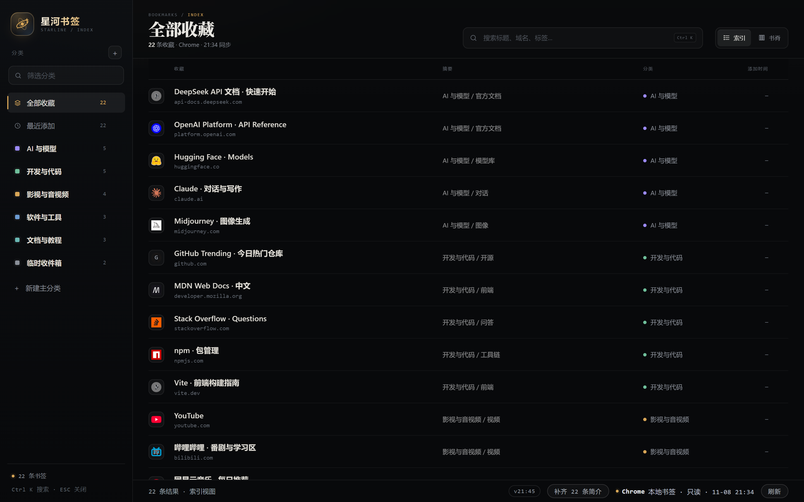
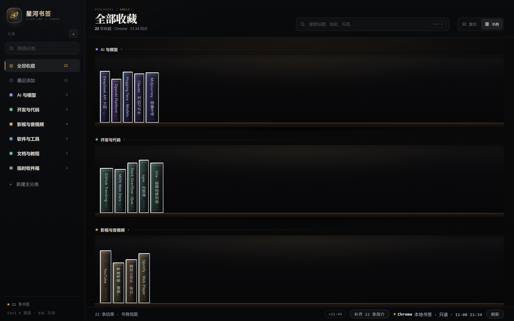
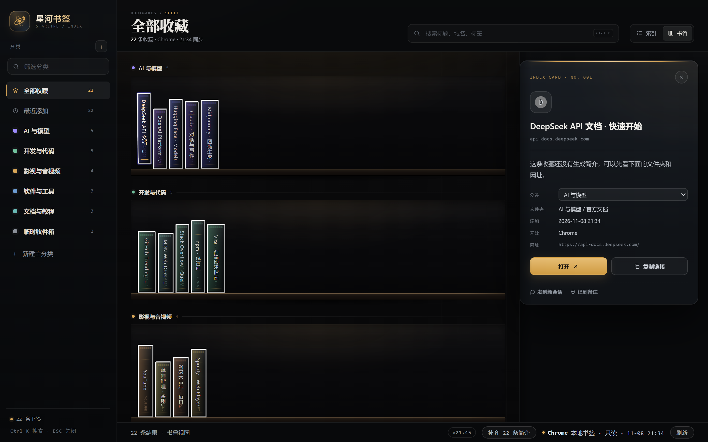

# 星河书签 · dsh-bookmarks-desk

> 把浏览器收藏夹搬进 [DeepSeek Harness](https://github.com/deepseek-ai) 侧栏：书脊书架、无限层级分类、即时搜索、卡片详情。
> Your browser bookmarks as a shelf inside DeepSeek Harness — shelf view, nested categories, search, card detail.



## 它是什么

DSH 的侧栏多一个「星河书签」面板。它读你本机 Chromium 系浏览器的书签文件，**只读不改**，然后以两种视图呈现：

- **索引视图** — 一行一条，标题 / 域名 / 简介 / 分类 / 添加时间，键盘 `Ctrl K` 搜索，`↑ ↓` 选，`Enter` 开。
- **书脊视图** — 按分类分层的书架，一本书就是一条收藏，鼠标悬停出浮层，点开在右侧停靠卡片。

分类是**你自己的**，不是插件预置的。建多少层都行，插件不会往你的分类体系里塞东西。



## 功能

- **两套视图**：索引列表 / 书脊书架，一键切换，滚动位置和选中项都记得。
- **无限层级分类**：左栏内联新建主分类 → 在任意分类上 `⋯` 新建子分类，一直往下建；双击改名；`⋯` 里可上移 / 下移 / 删除（删父级会级联删子级，书签本身不丢，退回「未分类」）。
- **系统视图**：全部收藏 / 最近添加 / 未分类，随数据实时计数。
- **分类筛选**：左栏搜索框过滤分类名，命中项连同祖先链一起保留，层级缩进和引导线跟着走。
- **卡片详情**：简介、分类下拉框直接改归类、文件夹路径、添加时间、来源、网址，以及「打开 / 复制链接 / 发到新会话 / 记到备注」。
- **悬浮不挡手**：鼠标在左半屏时浮层出在右侧，在右半屏时出在左侧；点开后卡片停靠，列表自动让位。
- **只读安全**：不写浏览器书签文件，不动你的 Chrome 配置。



## 安装

> 需要 DSH `>= 0.2.1-rc.5`，Node `>= 20`。

### 方式一：DSH Desktop

打开 **设置 → 插件**，搜索 `dsh-bookmarks-desk` 安装，然后重启应用。

### 方式二：命令行（GitHub）

```sh
dsh plugin --profile desktop add github:hanxiaoxin0715/dsh-bookmarks-desk
```

装完重启 `dsh web`（或 DSH Desktop），侧栏会出现「星河书签」。

### 方式三：命令行（npm，发布到 npm 之后）

```sh
dsh plugin --profile desktop add dsh-bookmarks-desk
```

> `--profile desktop` 换成你自己的 profile 名即可。DSH Desktop 自带的那份 profile 建议用应用内的插件设置，命令行改不动它正在运行的状态。

### 卸载

```sh
dsh plugin --profile desktop remove dsh-bookmarks-desk
```

本地面板数据在 `~/.dsh/bookmarks-desk/`，需要一并清掉就手动删这个目录。

## 支持的浏览器与平台

| | Windows | macOS | Linux |
|---|---|---|---|
| Chrome | ✅ | ✅ | ✅ |
| Chrome Beta | ✅ | ✅ | ✅ |
| Edge | ✅ | ✅ | ✅ |
| Brave | ✅ | ✅ | ✅ |
| Chromium | ✅ | ✅ | ✅ |

默认只读 **Chrome**。想同时合并多个浏览器，设置环境变量：

```sh
# Windows PowerShell
$env:BOOKMARKS_DESK_BROWSERS = "chrome,edge"

# macOS / Linux
export BOOKMARKS_DESK_BROWSERS=chrome,edge,brave
```

可用值：`chrome`、`chrome-beta`、`edge`、`brave`、`chromium`。主力浏览器里一条都读不到时，会自动回退去试其它浏览器，避免面板空着。

登录态下的 Chrome 会把书签写到 `AccountBookmarks`，插件优先读它，读不到再退回普通的 `Bookmarks`。

## 数据与隐私

- **只读**：插件只 `readFile` 浏览器书签文件，从不写入。
- **本地存储**：你的分类、改名、简介、置顶都在本机 `~/.dsh/bookmarks-desk/`：
  - `overrides.json` — 分类树、每条收藏的归类/改名/简介、文件夹映射
  - `enrich.json` — 助手生成的简介缓存
  - `pins.jsonl` — 置顶记录
- **不上传**：插件没有任何上报逻辑，也不会把书签发给第三方。
- 本仓库里的截图全部是虚构演示数据，不含任何真实书签。

## 配置

| 环境变量 | 默认 | 说明 |
|---|---|---|
| `BOOKMARKS_DESK_BROWSERS` | `chrome` | 逗号分隔的浏览器 id，决定读哪几个浏览器的书签 |

## 示例数据与本地预览

仓库里的 `examples/demo-bookmarks.json` 是 **22 条虚构收藏 + 6 个示例分类**，不含任何真实书签。想改演示内容直接编辑它。

**不装 DSH 也能看面板：**

```sh
node scripts/preview.mjs
# 星河书签预览：http://127.0.0.1:62605/
```

它会起一个本地服务，把示例数据注入真实面板，然后自动打开浏览器。改 `panel/index.html` 刷新即可看到效果，不需要构建。

## 批量归类（可选）

`scripts/classify.mjs` 会按**你自己建好的分类**把浏览器书签批量归一次。不预设任何分类名，判定依据：

1. **文件夹同名**：书签所在文件夹与分类同名（+10）或互相包含（+6）
2. **分类名命中域名/标题**：分类叫 `Github` → `github.com`（+8）；分类名出现在标题里（+4）
3. **内置主题词典**：分类名里出现「AI / 设计 / 服务器 / 交易…」等主题词时，自动启用该主题的域名与关键词
4. **自定义规则**：`--rules ./my-rules.json` 追加 `{ "categories": { "分类名": { "domains": [...], "keywords": [...] } } }`

```sh
node scripts/classify.mjs                    # 只打印分布，不写入
node scripts/classify.mjs --samples 8        # 顺便看每个分类的命中样本
node scripts/classify.mjs --write            # 写入（自动备份 overrides.json）
node scripts/classify.mjs --inbox 收件箱 --write   # 没命中的归到「收件箱」，没有就自动建
```

归类结果只写 `~/.dsh/bookmarks-desk/overrides.json`，**不碰浏览器书签文件**。

## 目录结构

```
index.js                  宿主半面：读书签、分类、路由（/bookmarks-desk/*）
client.js                 客户端半面：注册 sidebar.panellist 面板、托管 iframe
panel/index.html          面板 UI（单文件，无外部依赖、无构建步骤）
cordis.patch.yml          插件插入声明
locale/                   中英文面板名与描述
examples/demo-bookmarks.json  示例收藏（预览与截图用，全是虚构数据）
scripts/preview.mjs       本地预览（不需要 DSH）
scripts/classify.mjs      通用批量归类
icon.svg                  图标
```

## 开发

面板是**单文件 HTML**，没有构建步骤：`node scripts/preview.mjs` 起服务，改 `panel/index.html` 刷新页面即可。

宿主接口都挂在 `/bookmarks-desk` 下：

| 路由 | 作用 |
|---|---|
| `GET /state` | 书签索引 + 分类 + 统计 |
| `GET /panel/` | 面板 HTML |
| `POST /category/add` `/update` `/rename` `/reorder` `/remove` | 分类增删改与排序 |
| `POST /category/assign-item` `/assign-folder` | 改单条收藏 / 整个文件夹的分类 |
| `POST /override` | 改单条收藏的标题、简介、标签 |
| `POST /classify` `/classify/start` `/classify/status` `/classify/stop` | 用当前模型批量归类 |
| `POST /pin` `/open` `/refresh` | 置顶、用系统浏览器打开、重读书签 |

插件通过 profile 的 `dsh.profile.bundles` 加载，开发时用本地 link 安装：

```json
{ "dependencies": { "dsh-bookmarks-desk": "link:/path/to/dsh-bookmarks-desk" } }
```

## License

[MIT](LICENSE)
